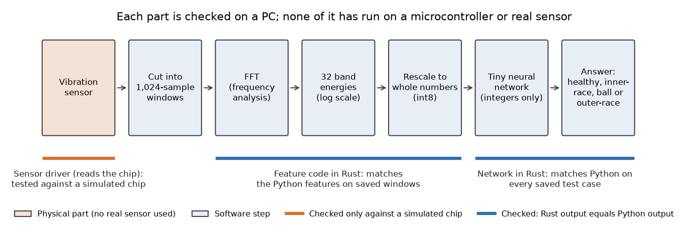
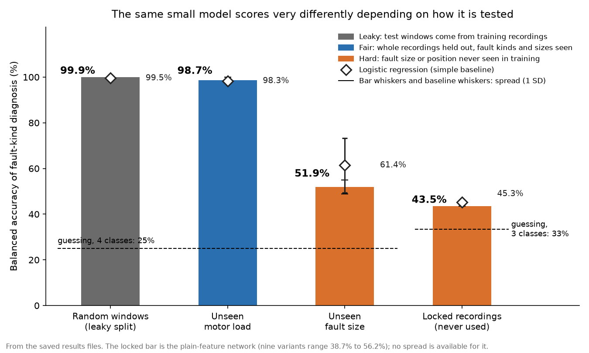
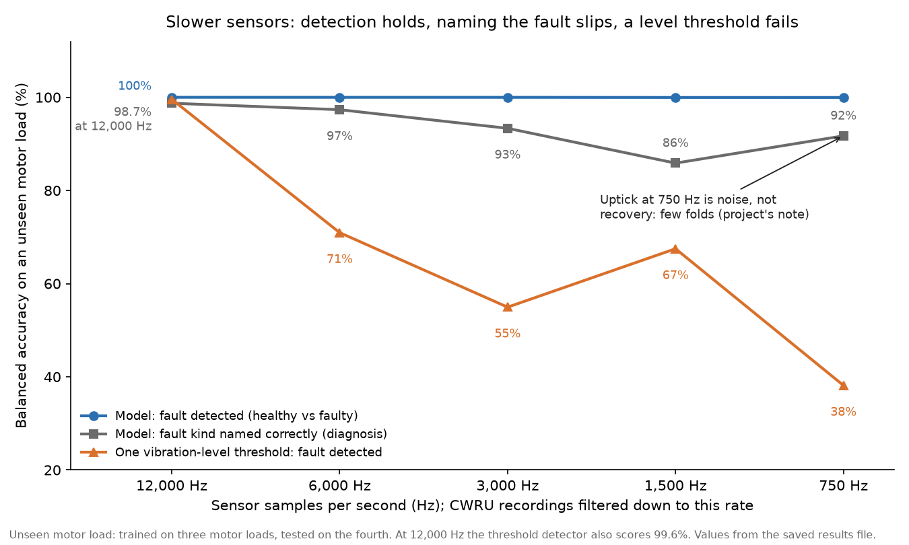

# Sustain-IQ

*A small program that listens to a machine's vibration and says whether its bearing is healthy or faulty, shrunk step by step towards a size that fits on a microcontroller, with a record of what each step costs.*

Status: phase 1 (everything that can be done on a PC) is finished; phase 2 (running on a real microcontroller with a real sensor) is prepared but has not started on hardware. Last change 23 October 2026. Code: https://github.com/PCSchmidt/sustain-iq (public, MIT licence, a permissive open-source licence). All results come from a public lab dataset.

A bearing is the part that lets a shaft spin smoothly inside a motor or a pump. When one starts to fail, the machine vibrates differently, and an accelerometer (a small chip that measures shaking) can pick that up. The dream is a cheap, battery-powered sensor on every pump and fan that raises a flag before something breaks. Such a sensor is run by a microcontroller, a tiny computer on one chip with very little working memory (RAM) and little permanent storage (flash, where the program lives). Sustain-IQ takes one small decision-making model, trained on public bearing recordings, and shrinks it for such a chip, measuring what each reduction costs. I will say "the README" for the project's front page and "the design notes" for its technical notes; both are written by the author and are the main sources besides the code and saved result files.

**The conclusion.** The results are mixed. I use two words throughout. *Detection* is telling a faulty bearing from a healthy one. *Diagnosis* is naming the kind of fault (inner-race, ball or outer-race, after the damaged part). Scores are *balanced accuracy*: for each class, the share of its test examples (short slices of the recordings, called windows) named correctly, averaged over classes, so a common class cannot hide a rare one. Guessing among four classes scores 25%.

- Detection is dependable, even from a slow, cheap sensor. Slowed from 12,000 samples per second down to 750, the model still detects faults essentially every time, while a single loudness threshold, on the unseen-motor-load test, falls to between 38 and 71% once the sensor is slowed.
- Diagnosis is not dependable. It scores 99.9% when tested the easy way, 98.7% on a motor load it has not seen, but only 52% (against 25% for guessing) on a fault size it has not seen.
- The shrinking worked. The model has about 1,650 adjustable settings (weights, the numbers learned in training). Stored as int8 (whole numbers from minus 127 to 127, one byte each) it fits in under 2 kilobytes of flash, and a Rust version (Rust is a programming language used for small devices) gives exactly the same answers as the Python original.
- The device is missing. Nothing has run on a microcontroller, so speed, memory and battery figures are arithmetic estimates only. Everything comes from one lab test rig, so none of it shows how a real machine behaves.

AI coding agents wrote almost all of the code, and I directed the scope, plan, architecture and preferences.

A calculator gives the same answer every time; a weather forecast is a judgement learned from past weather and can be wrong. Turning vibration into numbers, and the shrunken model's integer arithmetic, are calculator-like. The model itself is forecast-like: it learned from example recordings, it reports only its highest-scoring class (no confidence figure), and it can be wrong on conditions unlike its training. Chance enters through random starting values in training, so results are averaged over three training runs with fixed seeds (starting numbers that make a random sequence repeat exactly). The project's defence is how it tests, described below.

## What problem this solves

Condition monitoring means watching a machine's health through its signals so maintenance happens before a failure. A vibration analyst or an expensive sensor package can do it; a cheap sensor-plus-chip is attractive because you could fit one to everything. But a cheap chip cannot run big models, and a cheap sensor samples slowly. So: how small can the model be, and how slow can the sensor be, before the answers stop being useful?

The README names a concern: bearing-fault classifiers are often scored on windows of vibration cut from the very recordings they trained on, which flatters them. The project reports tougher tests as well.

In short, the project exists to measure what shrinking costs, and to test more strictly than the common leaky way.

The repository names no users; it is a study and a reference implementation, not a product. Its only stated reason is the README's question about what each reduction costs. It is part of my physical-ai-portfolio index and, per the README, applies measurement habits from two sibling projects (Sentinel Node and TriageBox). It deliberately includes no controlled or employer data, no weapons or targeting functions, and no key management or security review (the design notes defer those to a later project).

## What it does today

I will follow one piece of vibration through the chain.

The data is from the Case Western Reserve University Bearing Data Center (CWRU), a public collection from a lab test rig: a motor whose bearing had faults cut at known sizes, recorded at 12,000 samples per second (12,000 Hz, hertz meaning per second). The project uses 40 recordings: healthy, plus three fault kinds at three sizes (0.007, 0.014 and 0.021 inch) and four motor loads (0 to 3 horsepower, how hard the motor works).

In the finished system, a *sensor driver* (the small piece of code that talks to the accelerometer chip and collects its samples) would feed the chain. No real sensor has been used: the driver is tested only against a *simulated chip*, a software stand-in written to follow the chip's datasheet (its maker's specification).

Each recording is cut into windows of 1,024 consecutive samples (about 85 thousandths of a second), sliding along by 512. Each window goes through an FFT (Fast Fourier Transform, a standard method that turns a wiggly signal into how much energy sits at each frequency). The energy is grouped into 32 frequency bands and rescaled to small whole numbers (int8), which go to the model.

The model is an MLP (Multi-Layer Perceptron), the simplest kind of neural network: each layer multiplies its inputs by learned weights, adds a bias, and sets negatives to zero. Mine takes 32 numbers in, has two middle layers of 32 and 16 units, and ends in 4 outputs (healthy, inner-race, ball, outer-race); the highest score names the class. Written 32-32-16-4, it has 1,652 weights and biases.



A fair picture is a mechanic listening to an engine for the healthy hum against knocking patterns. It breaks down because a mechanic generalises to an engine never heard before, while this model mostly cannot generalise to fault sizes it has not seen.

The user runs the Python scripts to reproduce the studies, or the Rust tests; there is no application.

In short, a vibration window becomes 32 numbers, then a four-way answer, all on a PC so far.

## How it works: parts, data and tools

There are five working parts. A Python library cuts windows, computes features, builds the test splits, trains the network (with the numpy numerical library) and converts it to integers. Scripts download the data and run each study. Three small Rust libraries repeat the same chain of steps for a device: the integer network, the feature code, and the sensor driver. A fourth Rust folder holds minimal firmware images for the Raspberry Pi Pico 2, a roughly $5 board built on the RP2350 microcontroller; one blinks a light, one checks that the feature code links for that chip. The accelerometer is an ADXL345, a common low-cost sensor that the design notes say is on order.

The rules the system must not break are about testing and arithmetic. Every reported score holds out whole recordings. Rescaling of features uses only training data. And the integer network must give identical results in Python and Rust, which tests check by exporting the Python model's integers and demanding that the Rust code reproduce every output.

The data is downloaded by script (64 files, about 190 megabytes) and not redistributed; the README asks users to cite the Bearing Data Center. One quirk is handled: one healthy file contains a copy of another file's recording as well as its own, so the loader picks the variable named for the file, and a test covers that.

In short, the parts are a Python study, three Rust libraries and a board-preparation folder, held together by tests that demand identical answers.

## The methods, and why they were chosen

**Band energies.** The features are cheap on a chip: one fixed-size FFT per window, adding up, and a logarithm. Two other feature sets were tried: "band shape", which ignores overall loudness, and an "envelope spectrum", the classic bearing-diagnosis method, which looks for the rhythm at which a damaged spot is struck.

**Fair splits.** Neighbouring windows from one recording are near-copies. If random windows are held out for testing, each has near-twins in the training set, a leak. The project instead holds out whole recordings: one motor load (train on three, test on the fourth) or one fault size (train on two, test on the third). Each such round is a *fold*. A third arrangement, the *locked set*, is 24 further recordings (larger 0.028-inch inner-race and ball faults, and outer-race faults at other positions on the bearing) never used for training, tuning or choosing, and evaluated after the other studies. An exam analogy: a random split is a test of practised questions, a held-out size is new questions of a familiar type, and the locked set is a different exam. It breaks down because even the hardest test uses lab data from one rig.

**Balanced accuracy, by example.** Take seven windows: four truly healthy, two inner-race, one ball. The model gets all four healthy right, one of two inner-race right, and the ball right. The hit rates (recall) are 1, 0.5 and 1, so balanced accuracy is 0.83, while plain accuracy would be 6 of 7, 0.86. (This is modelled on one of the project's unit tests.)

**Quantisation.** Quantisation means storing the model's numbers as small whole numbers instead of decimals, which saves memory and suits a chip with no decimal-arithmetic hardware. The weights become int8 (in one study, int4: four bits, 15 possible values). The scheme is written by hand rather than taken from a machine-learning framework; the design notes say that is what makes an exact Python-versus-Rust comparison possible. After each middle layer the running sum is scaled down by a fixed factor, rounded, and capped to the range 0 to 127. For example, with a factor of one half, a sum of 3 becomes 2 (1.5 rounded up), minus 10 becomes 0, and 1,000 is capped at 127.

**Two simple baselines.** A logistic regression is a classic statistical classifier that draws straight-line boundaries between classes; a network that does not beat it has not earned its complexity. The second baseline is a detector with one threshold on a window's RMS (root-mean-square, a single "how big is the vibration" number): if loudness alone finds the fault, the model adds little for detection.

In short, each method is there to keep the scores honest or the model small.

## The model, and what it gets right and wrong

There is one model: the 32-32-16-4 MLP, trained from scratch on the 40 recordings with a loss that weights rare classes up, the Adam optimiser (a common method for adjusting the weights) and 60 passes through the data. It runs on a PC with no pre-trained model and no outside service, so there is no running cost. The design notes chose an MLP over a CNN (convolutional neural network, a larger kind that can read the raw waveform); no CNN was tried.

Its mistakes are structured. Across an unseen fault size, healthy windows are never confused with faulty ones, but the three fault kinds are confused with each other: only 29% of inner-race windows are called inner-race, 58% of ball windows are called ball, and 30% of outer-race windows are called outer-race. There is no human in the loop and no safeguard beyond the testing; it acts on nothing.

In short, one small network, trained from scratch, that cannot tell fault kinds apart once the fault size changes.

## Does it work? The results

The numbers are balanced accuracy from the saved result files, averaged over folds and three training runs. A quoted spread is a standard deviation across folds and runs, not a confidence interval.



Random windows pooled across recordings score 99.9%, the leaky number. Holding out a motor load gives 98.7% (spread 1.2 points). Holding out a fault size gives 51.9% (spread 3.0), where the logistic regression does better at 61.4% (spread 11.9), so more model did not help. On the locked recordings the nine variants (three feature sets, three models) score 38.7% to 56.2%; the 43.5% in the chart is the plain-feature network. The locked set holds only fault recordings, so guessing there is 33%. The leak alone explains only about a point, because the classes separate well across motor loads; the big drop comes from testing on a condition the model has not seen.

Three feature sets did not fix this. After the plain features failed on unseen fault size, band shape and the envelope spectrum were tried. Neither generalised across fault size, and the envelope features were clearly worse across motor loads (83.9% against 98.7%). They were designed after seeing the failure and scored on the same folds, so they are exploratory; the locked set was evaluated afterwards for every variant and nothing was selected from it. There, the plain and shape feature networks name every larger inner-race fault and miss every larger ball fault; the envelope features do roughly the opposite. All variants flag the locked windows as faulty 97 to 100% of the time.

Detection is the dependable function: 100% at the full sample rate wherever both healthy and faulty recordings exist, and 97 to 100% on the locked set. The project's own write-up says this is nearly trivial at 12,000 samples per second, since one loudness threshold already finds 95 to 99.6% of faults. The more interesting question is a cheaper sensor.



To emulate slower sensors, the recordings were low-pass filtered (high frequencies removed) and thinned out. The chart uses the unseen-motor-load test: train on three motor loads, test on the fourth. Detection stays at essentially 100% down to 750 samples per second, while the one-threshold detector falls to between 38 and 71% once the high frequencies are gone: the information is in the shape of the low-frequency spectrum, not the total loudness. Naming the fault worsens as the rate falls (98.7% at 12,000, 93% at 3,000, 86% at 1,500, then 92% at 750, which the project says is noise from few folds, not recovery). The filter was ideal; the ADXL345's own filtering is softer, so the design notes say to repeat the study with a closer sensor model before trusting the result at its 3,200-per-second rate.

On model size:

| Hidden layers | Weights and biases | Flash at int8 (bytes) | Diagnosis, unseen load: float / int8 / int4 |
| --- | --- | --- | --- |
| 4, 4 | 172 | 224 | 97.6% / 97.3% / 94.7% |
| 16, 8 | 700 | 800 | 99.1% / 99.0% / 98.6% |
| 32, 16 (deployed) | 1,652 | 1,824 | 98.7% / 98.7% / 98.3% |
| 64, 32 | 4,324 | 4,640 | 99.0% / 99.0% / 98.9% |

"Float" is the ordinary decimal version. Beyond about 700 weights there is no gain; int8 costs at most 0.3 points and int4 between 0.1 and 3. The int4 results are simulated (weights limited to 15 levels but stored as int8) and the Rust code does int8 only. Flash figures are counted, not measured on a chip.

The Rust network reproduces every output of the Python integer reference on all 305 saved test cases (300 real windows and five extreme-value cases). A Rust feature extractor reproduces the Python features on 52 committed windows, worst error about 0.0001 on the log scale; the design notes also report a larger local check whose data is not in the repository.

Caveats for the whole chapter: one lab rig; the healthy side of the unseen-size test is split by time within the same recordings, so its false-alarm figure is optimistic; the locked set has no healthy recordings, so says nothing about false alarms; and three training runs and a handful of folds are too few for confidence intervals. All of phase 1 arrived in a single commit, so the history cannot show that the locked-set plan came before the results; that rests on the project's own account.

In short, the results say detection survives a slow sensor and diagnosis does not survive new fault sizes.

## Edge cases, testing and safeguards

There are 51 automated tests, and all pass in a fresh copy: 32 in Python (using small synthetic stand-ins, no CWRU data) and 19 in Rust. They check single pieces (a tone at a known frequency lights the band containing it; rounding goes up at exactly one half), compare Rust against numbers exported from Python, and check that splits never put a recording on both sides.

One edge case worth telling: a stuck sensor, where every sample in a window is the same. The Rust feature code returns the exact floor value, because a plain average left a rounding residue that produced noise; the Python code has a milder form of the flaw. And one bug was caught by the simulated chip: the sensor needs a 5 microsecond pause between reads, and the driver first held the chip selected during the pause, which the simulator, enforcing the datasheet's timing rule, rejected.

Not covered: anything on real hardware or real sensor noise. The simulated chip shares the author's reading of the datasheet, so agreement shows consistency, not that the chip behaves so. The studies themselves are not tested, since they need the downloaded data. An automated service runs the tests, code-style checks and a cross-build for the microcontroller's processor on every push; all five runs passed. It runs no study, so the result tables are not re-checked automatically.

In short, the tests show the pieces agree with each other, not that they work on real hardware.

## Could it be put into real use?

No, not yet. On the scale from experiment, to works on a laptop, to deployable, to operated, Sustain-IQ sits at works on a laptop: it passes its tests on a PC and the docs report its studies run there, but nothing runs on a device, nothing is hosted, and the repository names no user other than its author. It has no stars or forks, and the repository has no way to feed the model live data.

Three steps would help most. Run the bring-up checklist on a real board and sensor, recording sample rate, speed per window, flash, RAM and energy, which turns estimates into measurements (roadmap phase 2). Collect data from a real rig (the roadmap suggests a box fan with weights added) to see whether detection survives outside CWRU. And train and report a detection-only variant, which the design notes list as an open decision. So far it is a study without a device.

In short, it is not ready for real use, and the first missing piece is a device run.

## Strengths, shortcomings and the work still to do

Strengths: tests hold out whole recordings and are compared with two simple baselines; a locked set was kept apart; weak results are reported openly; and the integer arithmetic is written out so Rust and Python can be compared exactly.

Shortcomings, in order of weight: diagnosis does not generalise across fault size or position (the design notes leave open whether to ship detection-only); the lab-rig and no-device limits above mean the claim that this fits and is fast enough rests on counting; and smaller gaps, such as an older design-notes paragraph that still calls the sensor's SPI mode (its wiring protocol) unverified when the newest commit marks it confirmed from datasheet text, and a Python side with no locked dependency file.

The roadmap has the PC-side chain, studies and bit-exact Rust engine done, device preparation done on the host, and running the model on the device, own-rig data and detection-only comparisons planned.

In short, the next real step is the hardware run.

## How it was built, and who did what

All five commits, made between 17 and 23 October 2026, carry the same AI co-author credit, and the repository has no agent instruction files, so it shows no more than that. Decisions recorded in the design notes are whole-recording tests, reporting detection and diagnosis separately, always including the simplest baseline, and a hand-written integer scheme. The one mistake caught by checking is the driver timing bug above. Otherwise the checks visible are tests, saved results and notes saying what was and was not measured.

In short, AI coding agents built it under the author's direction, and the visible checks are tests, saved results and candid notes.

## For recruiters and interviewers

In thirty seconds: a small vibration classifier on public bearing data, shrunk to under 2 kilobytes and reproduced exactly in Rust, with a test design that exposes where it fails. The detail is above.

| Typical requirement | What the project shows | Strength |
| --- | --- | --- |
| Evaluation and reporting of results | Whole-recording splits, locked set, baselines, negative results | Partly (no confidence intervals; one dataset) |
| Embedded or edge machine learning | Quantisation, integer-only Rust model code, feature code, sensor driver | Simulated (host only) |
| Software practice | 51 passing tests, style, lint and cross-compile checks | Partly |
| Deploying and operating | Nothing hosted, no users | Not shown |

The roles I am aiming at are AI engineer, forward-deployed AI engineer and applied AI or machine-learning engineer. The guide's reading, not a statement from me, is that the nearest match is applied machine learning with an embedded flavour; the project has no customer setting and no language-model workflow. What not to claim: that it runs on a microcontroller, that results hold on real machines, or that diagnosis works.

Two likely questions: where do the numbers come from (the saved result files, which the documents quote, and the Rust test, which uses committed vectors) and why not just a threshold (at full rate it works; at lower rates it falls to 38 to 71% while the model stays near 100%). A demo: the four-way test chart, the slow-sensor chart, then the Rust test with every saved vector matching.

In short, the honest pitch is a well-tested study with a clear negative result and no device yet.

## Where to look in the code

```text
sustain-iq/
  src/sustain_iq/   windows, features, splits, numpy network, quantisation, export
  scripts/          download data, run studies, build tables and figure, export test vectors
  firmware/         tinyinfer (network), tinyfeat (features), tinyadxl (sensor driver), pico2-bringup (board images)
  results/          saved results (JSON) behind every number
  tests/            Python tests
  docs/             results, design, roadmap, bring-up checklist
```

Python entry points are the scripts; the quantiser and the feature code are the two most important library files. Python tests run with `pytest` after `pip install -e ".[dev]"`; each Rust library runs `cargo test` from its folder. The studies need the CWRU download first.
